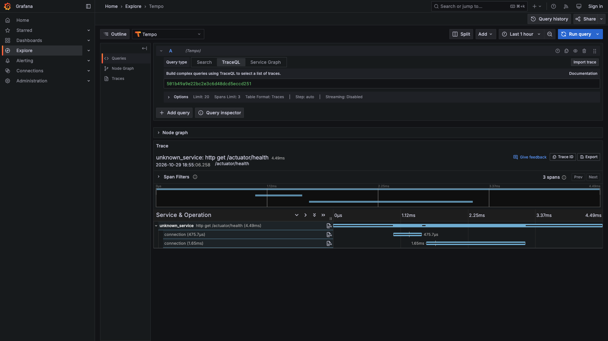

# Cocos Capital — Backend Challenge

API en Java para consultar el portfolio de un usuario, buscar activos y enviar y cancelar órdenes al mercado. Resuelve el [backend challenge de Cocos Capital](https://github.com/cocos-capital/cocos-challenge/blob/main/backend-challenge.md); Cocos pidió explícitamente implementarlo en Java (el enunciado original menciona Node.js).

## Requisitos

- **Java 25** (LTS)
- **Docker** y Docker Compose (base local y Testcontainers en los tests)
- Gradle Wrapper incluido (no hace falta instalar Gradle)

## Base de datos local

Levantá PostgreSQL 17 con la configuración por defecto del proyecto:

```bash
docker compose up -d
```

Credenciales: base `cocos`, usuario `cocos`, contraseña `cocos`, puerto `5432`.

> **Advertencia:** la aplicación **no debe ejecutarse contra la base de Neon provista por Cocos**. Flyway aplicaría migraciones sobre una base que probablemente es compartida entre candidatos. Usá siempre la base de `docker-compose` (o un Postgres propio).

## Ejecutar la aplicación

Con la base local arriba:

```bash
./gradlew bootRun
```

Al arrancar, Flyway aplica la migración `V1` (seed de Cocos). El health check queda en:

```bash
curl http://localhost:8080/actuator/health
```

La conexión se configura con `DB_URL`, `DB_USERNAME` y `DB_PASSWORD`. Los valores por defecto apuntan a `jdbc:postgresql://localhost:5432/cocos` con usuario y contraseña `cocos`.

## Observabilidad

La app instrumenta métricas y trazas con Micrometer / OpenTelemetry (ADR-009). **Por defecto no exporta nada** por OTLP: arranca sin colector y no llena el log con errores de conexión.

Los logs van a **consola** en JSON (ECS) e incluyen `trace.id` / `span.id` cuando hay una traza activa. ADR-009 no exporta logs por OTLP a Loki: la correlación log↔traza se hace copiando el `trace.id` del log de consola y buscándolo en Tempo (Grafana).

Para ver métricas y trazas en local:

```bash
docker compose --profile observability up -d
SPRING_PROFILES_ACTIVE=observability ./gradlew bootRun
```

Abrí Grafana en [http://localhost:3000](http://localhost:3000). Ahí vas a poder ver:

- Métricas HTTP (`http.server.requests`), del pool HikariCP y de la JVM
- Trazas de cada pedido, con spans de JDBC (texto SQL, **sin** valores de parámetros)

Ejemplo de traza HTTP + JDBC en Tempo:



`docker compose up -d` (sin perfil) sigue levantando solo PostgreSQL.

## Tests

```bash
./gradlew build
```

Los tests de integración usan Testcontainers (PostgreSQL 17) y requieren Docker.
