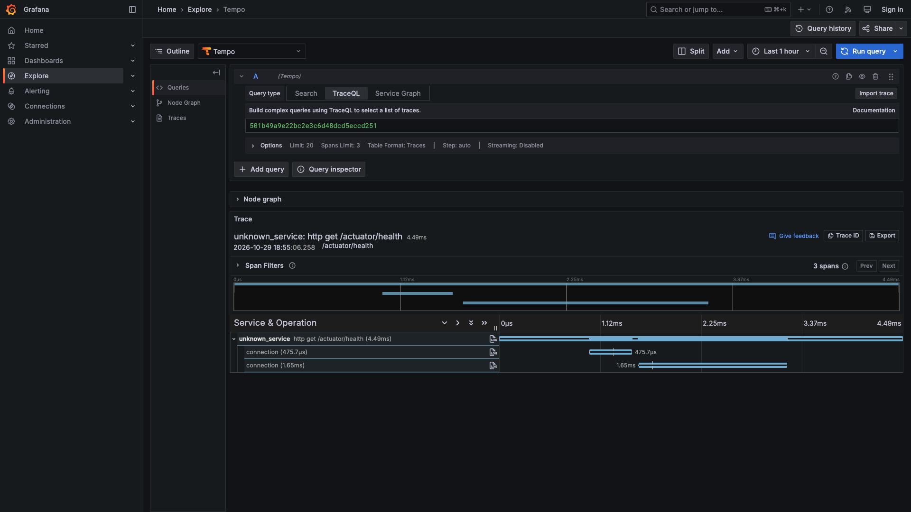

# Cocos Capital — Backend Challenge

API en Java para consultar el portfolio de un usuario, buscar activos y enviar y cancelar órdenes al mercado. Resuelve el [backend challenge de Cocos Capital](https://github.com/cocos-capital/cocos-challenge/blob/main/backend-challenge.md). El enunciado menciona Node.js, pero Cocos pidió explícitamente implementarlo en Java.

Además del código, el repo documenta el razonamiento: qué hace el sistema ([specs](docs/specs/README.md)), cómo está construido ([ADRs](docs/decisions/README.md)) y qué se supuso donde el enunciado no alcanza ([supuestos](docs/assumptions.md)).

## Cómo levantarlo

> **Advertencia:** la aplicación **no debe ejecutarse contra la base de Neon provista por Cocos**. Al arrancar, Flyway aplica las migraciones, y esa base probablemente es compartida entre candidatos. Usá siempre la base de `docker-compose` o un PostgreSQL propio.

### Opción A: todo con Docker (no hace falta Java)

Solo se necesita Docker con Docker Compose.

```bash
docker compose --profile app up -d --build
curl http://localhost:8080/actuator/health
```

La primera vez compila la aplicación dentro de la imagen, así que tarda unos minutos. Para bajar todo: `docker compose --profile app down`. Para empezar de nuevo con la seed original, agregá `-v`.

### Opción B: con Java 25

Requisitos: Java 25 y Docker. El Gradle Wrapper está incluido.

```bash
docker compose up -d        # solo PostgreSQL 17
./gradlew bootRun
```

La conexión se configura con `DB_URL`, `DB_USERNAME` y `DB_PASSWORD`. Los valores por defecto apuntan a la base de `docker-compose` (`jdbc:postgresql://localhost:5432/cocos`, usuario y contraseña `cocos`), que son valores de desarrollo local.

En los dos casos, Flyway carga la seed de Cocos y aplica las migraciones de normalización del esquema al arrancar.

## Cómo probarlo

- **Swagger UI:** [http://localhost:8080/swagger-ui.html](http://localhost:8080/swagger-ui.html), con cada endpoint, sus parámetros y sus respuestas, incluidos los errores. El OpenAPI está en `/v3/api-docs`; Postman e Insomnia lo pueden importar como colección.
- **[`api.http`](api.http):** una colección para la extensión [REST Client](https://marketplace.visualstudio.com/items?itemName=humao.rest-client) de VS Code. Recorre todos los endpoints de arriba hacia abajo contra una base recién creada, con un comentario por pedido que dice qué tiene que responder y qué escenario de la spec muestra.

### Recorrido rápido con `curl`

```bash
# Buscar un activo por ticker o por nombre (sin distinguir mayúsculas ni tildes)
curl "http://localhost:8080/instruments?ticker=GGAL"
curl "http://localhost:8080/instruments?name=rio%20de%20la%20plata"

# Portfolio del usuario 1 de la seed: valor total 889.756 y 627.500 ARS disponibles
curl http://localhost:8080/users/1/portfolio

# Enviar una orden. El header Idempotency-Key es obligatorio: un reintento con la misma
# clave devuelve la misma orden en lugar de registrar otra.
curl -X POST http://localhost:8080/users/1/orders \
  -H "Content-Type: application/json" \
  -H "Idempotency-Key: $(uuidgen)" \
  -d '{"instrument_id": 34, "side": "BUY", "type": "LIMIT", "size": 10, "price": 850}'

# Cancelar una orden NEW, con el id que devolvió el envío
curl -X POST http://localhost:8080/users/1/orders/<id>/cancel
```

## Endpoints

| Método y ruta | Qué hace | Respuestas |
|---|---|---|
| `GET /instruments` | Busca activos por `ticker` y/o `name`, con orden (`sort=TICKER` o `NAME`) y paginación (`page`, `size`) | 200, 400 |
| `GET /users/{userId}/portfolio` | Valor total, pesos disponibles y posiciones con valuación, rendimiento y variación diaria | 200, 400, 404 |
| `POST /users/{userId}/orders` | Envía una orden `MARKET` o `LIMIT`, por cantidad o por monto en pesos | 201 (también si queda `REJECTED`), 200 (reintento), 400, 404, 409, 422 |
| `POST /users/{userId}/orders/{orderId}/cancel` | Cancela una orden `NEW` y libera su reserva | 200, 400, 404, 409 |

- **JSON en snake_case.** Lo que no tiene valor va como `null` explícito.
- **Una orden rechazada no es un error.** Se registra y se responde con `201`, su estado `REJECTED` y su motivo (`INSUFFICIENT_CASH`, `INSUFFICIENT_HOLDINGS` o `NO_MARKET_PRICE`).
- **Los errores son Problem Details** (`application/problem+json`) con un `code` de un catálogo cerrado, por ejemplo `VALIDATION_ERROR`, `ACCOUNT_BUSY` o `IDEMPOTENCY_KEY_REUSED`. Nunca repiten valores enviados por el cliente.

## Decisiones principales

Cada decisión tiene su ADR con el contexto, las alternativas descartadas y las consecuencias.

| Tema | Decisión | ADR |
|---|---|---|
| Stack | Java 25, Spring Boot 4.1, PostgreSQL 17, Flyway y Testcontainers | [ADR-001](docs/decisions/ADR-001-stack.md) |
| Acceso a datos | SQL explícito con `JdbcClient`, sin ORM. El lock, el último precio (`DISTINCT ON`) y la búsqueda sin tildes (`unaccent`) son SQL de PostgreSQL, y así cada query se ve tal como se ejecuta | [ADR-002](docs/decisions/ADR-002-data-access.md) |
| Arquitectura | Hexagonal en un solo módulo. El dominio no depende de Spring, y ArchUnit verifica las dependencias entre capas y los nombres por rol | [ADR-003](docs/decisions/ADR-003-hexagonal-architecture.md) |
| Esquema | La seed de Cocos queda intacta como `V1`. Las migraciones siguientes normalizan nombres, tipos (`BIGINT`, `NUMERIC`, `TIMESTAMPTZ`) y enumerados en inglés, y agregan las restricciones | [ADR-004](docs/decisions/ADR-004-schema-and-migrations.md) |
| Saldos | El libro de órdenes es la fuente de verdad. El efectivo, las reservas y las posiciones se materializan en una proyección que se actualiza en la misma transacción que cada orden y se puede reconstruir desde el libro | [ADR-005](docs/decisions/ADR-005-materialized-accounts.md) |
| Concurrencia | Lock pesimista sobre la fila de la cuenta, con tiempo máximo de espera (`ACCOUNT_BUSY`). Dos órdenes simultáneas nunca gastan el mismo disponible | [ADR-006](docs/decisions/ADR-006-concurrency.md) |
| Errores | Problem Details (RFC 9457) con un catálogo cerrado de códigos | [ADR-007](docs/decisions/ADR-007-error-handling.md) |
| Idempotencia | Header `Idempotency-Key` obligatorio en el envío. La clave se guarda en la orden con una huella del pedido, sin tabla aparte | [ADR-008](docs/decisions/ADR-008-idempotency.md) |
| Observabilidad | Micrometer y OpenTelemetry, con métricas de negocio detrás de un puerto | [ADR-009](docs/decisions/ADR-009-observability.md) |
| Contrato | Recursos por usuario, snake_case, listas como objeto y paginación por offset | [ADR-010](docs/decisions/ADR-010-api-contract.md) |

## Supuestos

El enunciado deja definiciones de negocio abiertas. Las que cambian el comportamiento se consultaron a Cocos, que confirmó S1 a S6 el 2 de noviembre de 2026:

| ID | Supuesto |
|---|---|
| S1 | Una orden `LIMIT` en `NEW` reserva el disponible: `cantidad × precio límite` en una compra, las acciones en una venta. Al cancelarla, la reserva se libera |
| S2 | El rendimiento se calcula por posición, sobre el costo promedio ponderado |
| S3 | La tenencia negativa de BMA en la seed se informa tal cual, sin corregir el libro |
| S4 | Un usuario tiene una sola cuenta, modelada como entidad propia |
| S5 | Una orden `MARKET` sobre un instrumento sin cotización se rechaza con `NO_MARKET_PRICE` |
| S6 | Una orden por monto compra la cantidad entera que alcanza (`monto / precio`, truncado) y compromete solo `cantidad × precio` |

S7 a S14 son decisiones de diseño, por ejemplo que una `LIMIT` que cruza el precio queda `NEW`, o que el usuario se identifica en la ruta sin autenticación. Todas están en [`docs/assumptions.md`](docs/assumptions.md), con su fundamento y las specs que afectan.

## Specs y tests

El comportamiento está especificado por capacidad, con requisitos y escenarios GIVEN/WHEN/THEN. Cada escenario tiene un ID, y el test que lo verifica lleva ese ID en su `@DisplayName`, así que se puede buscar qué test cubre cada regla:

| Capacidad | Spec | Escenarios con test |
|---|---|---|
| Saldo y disponible | [`account-balance`](docs/specs/account-balance/spec.md) | 13/13 |
| Búsqueda de activos | [`asset-search`](docs/specs/asset-search/spec.md) | 22/22 |
| Portfolio | [`portfolio`](docs/specs/portfolio/spec.md) | 17/17 |
| Envío de órdenes | [`order-placement`](docs/specs/order-placement/spec.md) | 41/41 |
| Cancelación | [`order-cancellation`](docs/specs/order-cancellation/spec.md) | 10/10 |

```bash
./gradlew build
```

Corre los tests unitarios del dominio, los de integración contra PostgreSQL real con Testcontainers (requieren Docker) y las reglas de arquitectura de ArchUnit. Los escenarios concurrentes (dos órdenes o dos cancelaciones simultáneas, cuenta ocupada) usan hilos reales y verifican al final que la proyección coincida con el libro.

## Evolución prevista

Lo que se decidió no construir todavía, con el disparador que lo justificaría:

- **Checkpoints de la proyección:** acotan la reconstrucción de cuentas con historiales muy largos. Requieren que los cambios de estado de las órdenes sean eventos propios ([ADR-005](docs/decisions/ADR-005-materialized-accounts.md)).
- **Reconstrucción en segundo plano:** procesa las cuentas `PENDING` antes de su primera escritura, con `FOR UPDATE SKIP LOCKED` entre instancias ([ADR-005](docs/decisions/ADR-005-materialized-accounts.md)).
- **Lock optimista:** si `trading.account.lock.wait` mostrara contención real por cuenta ([ADR-006](docs/decisions/ADR-006-concurrency.md)).
- **Paginación con cursor:** si el catálogo de instrumentos creciera ([ADR-010](docs/decisions/ADR-010-api-contract.md)).
- **Ejecución de órdenes `LIMIT` por el mercado** y autenticación: fuera del alcance del enunciado.

## Observabilidad

La app instrumenta métricas y trazas con Micrometer y OpenTelemetry ([ADR-009](docs/decisions/ADR-009-observability.md)). **Por defecto no exporta nada**: arranca sin colector y no llena el log con errores de conexión. Los logs van a consola en JSON (ECS), con `trace.id` y `span.id` cuando hay una traza activa.

Las métricas de negocio son `trading.orders`, `trading.account.lock.wait`, `trading.account.busy`, `trading.idempotency.replays` y `trading.projection.rebuilds`. Ninguna lleva tags con el usuario, la cuenta ni el instrumento.

Para verlas en Grafana, junto con las trazas:

```bash
docker compose --profile observability up -d
SPRING_PROFILES_ACTIVE=observability ./gradlew bootRun
```

Grafana queda en [http://localhost:3000](http://localhost:3000), con las métricas HTTP, del pool de conexiones, de la JVM y de negocio, y con las trazas de cada pedido. Los spans de JDBC muestran el SQL, **sin** los valores de los parámetros.



## Estructura del repo

```text
src/main/java/com/cocoscap/challenge/
  domain/        reglas de negocio puras: cuenta, órdenes, política de envío, valuación
  application/   casos de uso y puertos (interfaces) hacia afuera
  adapter/       web (controllers y Problem Details), persistencia (JDBC), observabilidad
  config/        cableado de Spring
src/main/resources/db/migration/   V1 (seed de Cocos) y las migraciones siguientes
docs/specs/        comportamiento por capacidad
docs/decisions/    ADRs
docs/assumptions.md
AGENTS.md          cómo se trabaja en este repo, para personas y agentes de AI
api.http           ejemplos de invocación
```

El desarrollo se hizo por capacidad, en PRs chicos, con un ciclo de spec, plan, implementación y verificación. [`AGENTS.md`](AGENTS.md) describe ese flujo y las reglas que siguió cada PR. Las convenciones de cada capa, resumidas para aplicarlas al escribir código, están en [`.cursor/rules/`](.cursor/rules/).
